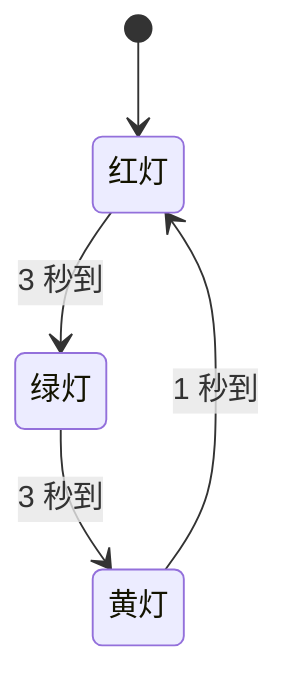

# 第 04 周 · 按键消抖与交通灯状态机

> 课程：嵌入式软件开发与工业控制（6 个月）  
> 平台：Wokwi 仿真 / Arduino Uno  
> 日期：2026-10-30

---

## 一、这周在练什么

一句话：**把「卡着等」换成「到点再看」。**

第 03 周的代码全靠 `delay()`，等 500 毫秒，这期间芯片什么都干不了。交通灯如果用 delay 写，红灯亮 3 秒的这 3 秒里按键完全失灵。

这周的四个验收项，全部指向同一个问题：**让程序在等待期间继续干活**。

---

## 二、状态转换图

三个状态循环流转，时间到了就走下一个。



对应代码里的 `state` 变量：

| state | 灯 | 停留时间    | 下一状态 |
| ----- | - | ------- | ---- |
| 0     | 红 | 3000 ms | 1    |
| 1     | 绿 | 3000 ms | 2    |
| 2     | 黄 | 1000 ms | 0    |

按键不改变这个循环，按键改的是 `mode`（运行模式）。

---

## 三、电路


| 元件 | 接到  | 备注             |
| -- | --- | -------------- |
| 红灯 | D10 | 串 220Ω 限流      |
| 黄灯 | D11 | 串 220Ω 限流      |
| 绿灯 | D12 | 串 220Ω 限流      |
| 按键 | D2  | 另一端接 GND，用内部上拉 |

三条灯路各自回到 GND，按键单独一条回 GND。所有 GND 在板子内部是连通的，接哪个孔都行。

---

## 四、完整代码

```cpp
const int R = 10, Y = 11, G = 12;
const int BTN = 2;

int state = 0;
unsigned long tState = 0;

int mode = 0;
bool last = HIGH;
unsigned long tBtn = 0;

void setLight(int r, int y, int g) {
  digitalWrite(R, r);
  digitalWrite(Y, y);
  digitalWrite(G, g);
}

void setup() {
  pinMode(R, OUTPUT);
  pinMode(Y, OUTPUT);
  pinMode(G, OUTPUT);
  pinMode(BTN, INPUT_PULLUP);
}

void loop() {
  unsigned long now = millis();

  // 按键消抖
  bool b = digitalRead(BTN);
  if (b != last && now - tBtn > 20) {
    tBtn = now;
    last = b;
    if (b == LOW) {
      mode = (mode + 1) % 3;
      state = 0;
      tState = now;
    }
  }

  // 按模式运行
  if (mode == 0) {
    if (state == 0) {
      setLight(HIGH, LOW, LOW);
      if (now - tState > 3000) { state = 1; tState = now; }
    } else if (state == 1) {
      setLight(LOW, LOW, HIGH);
      if (now - tState > 3000) { state = 2; tState = now; }
    } else {
      setLight(LOW, HIGH, LOW);
      if (now - tState > 1000) { state = 0; tState = now; }
    }
  } else if (mode == 1) {
    bool on = ((now - tState) / 500) % 2;
    setLight(LOW, on, LOW);
  } else {
    setLight(HIGH, LOW, LOW);
  }
}
```

---

## 五、三种模式

| mode | 表现                    | 现实含义         |
| ---- | --------------------- | ------------ |
| 0    | 红 3 秒 → 绿 3 秒 → 黄 1 秒 | 白天正常通行       |
| 1    | 黄灯每 500 ms 翻转         | 深夜车少，黄闪提醒    |
| 2    | 红灯常亮                  | 故障或紧急情况，全部禁行 |

按键按一下 `mode` 加一，三下转一圈回到 0。

---

## 六、四个关键点

### 1. 状态机：state + tState

两个变量配合：

- `state` 记现在在哪一步
- `tState` 记这一步是从什么时候开始的

判断条件永远是 `now - tState > 时长`，不满足就什么都不做，直接退出 loop。

### 2. 非阻塞：millis() 代替 delay()

```cpp
// 阻塞写法，等待期间什么都干不了
digitalWrite(R, HIGH); delay(3000); digitalWrite(R, LOW);

// 非阻塞写法，每圈看一眼，到点才动作
if (state == 0) {
  setLight(HIGH, LOW, LOW);
  if (now - tState > 3000) { state = 1; tState = now; }
}
```

loop 每秒能跑几万圈，所以按键随时按随时响应。

### 3. 消抖：20 毫秒时间窗

机械按键按下瞬间，金属弹片会弹跳 5–20 ms，产生一串通断。芯片扫描快，会当成按了好几次。

```cpp
if (b != last && now - tBtn > 20) { ... }
```

两个条件同时成立才算一次真实按键：**电平变了**，且**离上次确认的变化超过 20 ms**。

不用 `delay(20)` 消抖，因为那 20 ms 里程序又是卡死的。

### 4. unsigned long：时间变量的唯一正确类型

| 类型              | 范围         | 能表示多久      |
| --------------- | ---------- | ---------- |
| `int`           | ±32767     | 32.7 秒     |
| `unsigned int`  | 0 – 65535  | **65.5 秒** |
| `unsigned long` | 0 – 42.9 亿 | 49.7 天     |

`millis()` 返回 `unsigned long`。用 `unsigned int` 接它，程序跑过 65 秒就溢出，状态开始乱跳。

**规则：凡跟 `millis()` 沾边的变量，一律 `unsigned long`。**

时间比较用减法 `now - tState > 3000`，不要写 `now > tState + 3000`。前者在 49.7 天回绕时依然正确，后者会出错。

---

## 七、踩过的坑

**unsigned int 溢出。** 时间戳写成 `unsigned int`，编译能过，跑一分钟才炸。这类 bug 最难查，因为代码看起来完全正常。

**setLight 参数写错。** 写成 `setLight(HIGH, LOW, R)`，`R` 是引脚号 10，被 `digitalWrite` 当成 HIGH，结果红绿同亮。编译器不报错，只能靠眼睛。

**漏分号和类型。** `const R = 10` 少了 `int`；`{state = 1,tState = now}` 少了分号。看到 `expected ';' before '}'` 这种报错，往上找一行。

**状态顺序写反。** 写成了红 → 黄 → 绿。真实交通灯是红 → 绿 → 黄，黄灯是绿灯之后的过渡。

**代码和接线对不上。** 改引脚号只改代码不改线，灯就不亮。这类问题出现过两次。

---

## 八、验收清单

- [x] 画出交通灯状态转换图
- [x] 实现按键消抖逻辑
- [x] 实现至少 3 个交通灯状态
- [x] 避免用长时间阻塞延时承载所有逻辑

验证方式：

1. 全局搜 `delay(`，零结果
2. 按十下按键，模式走十步，不跳不重复
3. 三个灯都亲眼看到亮过

---

## 九、还能继续做的

**长按回零。** 短按切模式，长按 2 秒直接回 mode 0，不用按三下。实现上多一个"按下持续了多久"的判断。

**模式指示。** 现在只能靠串口看数字，或者靠灯的表现猜。等学了数码管或 OLED，把模式号显示出来，这个项目就完整了。

**双向路口。** 南北向 + 东西向，六个灯，两套状态机互锁。这是真实交通灯的样子，也是状态机真正开始有难度的地方。

---

## 十、一句话总结

状态机不是某种库或者语法，就是**一个变量记位置，一个变量记时间，然后每圈问一句「到了吗」**。

这句话能用到后面的所有项目里。
